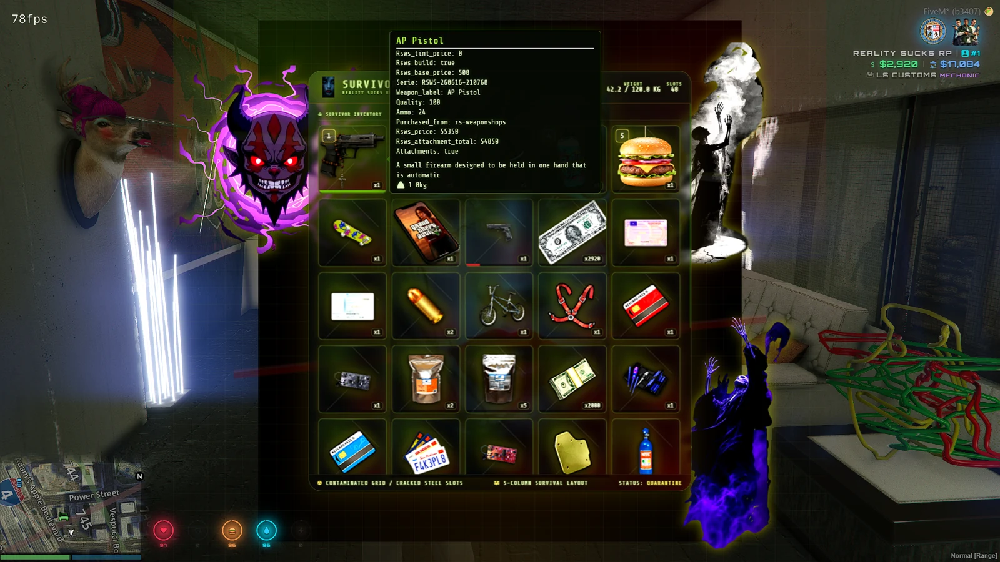

# RS Zombie Inventory

<a href="https://reality-sucks-rp-webstore.tebex.io/package/7506318"></a>

Build your inventory around the apocalypse. This QBCore edition brings zombie artwork and survival presentation together with physical cash, ground loot, weapon attachments, vehicle storage and item transfers. Customize the menu to match your survivor world.

[Download the original ZIP](https://github.com/RealitySucksRP/qb-inventory-Zombie-Menu-UI/releases/latest/download/qb-inventory-zombie.zip) | [Free on Tebex](https://reality-sucks-rp-webstore.tebex.io/package/7506318) | [Watch preview](https://youtu.be/HrOj98U_89w?si=DWQiC69TE38P6d6D) | [Website](https://realitysucksrp.github.io/) | [Discord](https://discord.gg/e9V3rPHySx) | [YouTube](https://www.youtube.com/@RealitySucksRP) | [All free scripts](https://reality-sucks-rp-webstore.tebex.io/category/free-scripts)

**Install folder:** `qb-inventory`. Download the original ZIP to retain the package folder layout. Source, configuration, licenses and included assets are provided below.

<details>
<summary>More screenshots</summary>



</details>

## Package documentation

# qb-inventory

> A reworked, hardened inventory for the QBCore framework, with the
> RealitySucksRP zombie UI. Cash as an item, weapon attachments, floor drops,
> player searching, and a server-authoritative backend.


---

## Preview

A two-panel layout with a five-column survival grid, framed by the zombie
artwork. Item art, weight, durability, decay and stack counts all render in the
slot. Right-clicking a weapon opens the attachment inspection panel.

The whole menu is themeable from a handful of CSS variables. See
[docs/ui-customization.md](docs/ui-customization.md).

---

## Features

- **Cash as an item.** Physical `cash` in the grid stays synchronized with
  QBCore buying power in both directions, with drift reconciliation and a
  `/cashcheck` command.
- **Weapon attachment panel.** Reads attachments saved by weapon shops in any of
  the common metadata formats, including prebuilt shop weapons. Nothing
  installed on a gun is ever invisible.
- **Floor drops.** Server-authoritative bags you can open, carry and set down,
  with idempotent drop handling and automatic refunds when bag creation fails.
- **Player searching.** Search dead or hands-up players through a server-issued
  robbery handshake.
- **Decay system** for food and drink, with expiry-aware stacking that can never
  extend an item's life.
- **Trunks, gloveboxes, stashes and shops** use server-owned sessions,
  routing-bucket checks and live proximity revalidation. Vending uses the same
  shop session layer plus network-entity verification where the prop is
  networked; optional strict coordinates are available for full server-side
  vending location authority.
- **Server-authoritative throughout.** Every item move is checked against what
  the server believes the player has open, and distance is revalidated on every
  move. See [Security](#security).

---

## Dependencies

| Resource | Required | Notes |
|---|---|---|
| [qb-core](https://github.com/qbcore-framework/qb-core) | yes | |
| [oxmysql](https://github.com/overextended/oxmysql) | yes | |
| [qb-target](https://github.com/qbcore-framework/qb-target) | yes | drops, vending, player search |
| [qb-weapons](https://github.com/qbcore-framework/qb-weapons) | yes | needs three small edits, see below |
| OneSync / state awareness | yes | required by the manifest for server entity, network-id and routing-bucket validation |

---

## Installation

**1. Install the resource**

Remove your existing `qb-inventory` and drop this folder in its place. The
folder must stay named `qb-inventory`, since other resources reference it by
name. Confirm OneSync/state awareness is enabled and dependencies start before the inventory:

```cfg
ensure qb-core
ensure oxmysql
ensure qb-target
ensure qb-weapons
ensure qb-inventory
```

The manifest declares the Cfx `/onesync` runtime constraint, so the resource
will not silently start without state awareness.

**2. Import the SQL**

```bash
mysql -u USER -p DATABASE < qb-inventory.sql
```

If you are upgrading an existing install, run `migrate.sql` instead.

**3. Patch qb-weapons**

Three small edits are required in the separate `qb-weapons` resource, or
detaching a shop-bought attachment silently does nothing. Full instructions with
copy-paste blocks are in
[REQUIRES_QB_WEAPONS_PATCH.md](REQUIRES_QB_WEAPONS_PATCH.md).

**4. Patch qb-core, if you want cash as an item**

This RealitySucksRP server build currently ships with `Config.CashAsItem = true`.
That mode requires the matching money-function edits in `qb-core/server/player.lua`
and a `cash` item in `qb-core/shared/items.lua`. Full instructions are in
[docs/qb-core-cash-as-item.md](docs/qb-core-cash-as-item.md).

Set `Config.CashAsItem = false` to use normal QBCore cash instead; the physical
cash synchronization/death-guard paths then remain dormant.

**5. Add your item images**

The resource includes a legacy item-image collection plus `missing.png` as a
fallback. Replace or remove any art you do not have redistribution rights for.
Custom item images go in `html/images/` as `<itemname>.png`; on Linux hosts the
filename is case-sensitive and must match the item definition exactly.

---

## Configuration

Everything lives in `config/config.lua`.

| Setting | Default | What it does |
|---|---|---|
| `CashAsItem` | `true` in this RS server build | Physical `cash` item synchronized with QBCore cash. Requires the documented qb-core patch; set false for normal QBCore money. |
| `CustomHUD` | enabled for `rs-lilhudlife` in this build | Hook to hide a custom HUD while inventory is open. Disable or repoint it on servers without that export. |
| `RobberyWebhook` | `''` | Discord webhook for player robbery logs. Empty disables logging. |
| `MaxWeight` / `MaxSlots` | `120000` / `40` | Player capacity. 40 slots suits the five-column layout. |
| `StackWithDifferentExpiry` | `true` | Stack non-unique items by name even when freshness differs. Merged stacks keep the earlier expiry. |
| `StashSize` / `DropSize` | | Capacity for stashes and floor drops. |
| `DropAccessDistance` | `3.5` | How far a player may stray from a drop before moves stop being honoured. |
| `PlayerAccessDistance` | `3.5` | Same, for another player's inventory during a search. |
| `ShopAccessDistance` | `6.0` | Same, for shops. |
| `StashAccessDistance` | `8.0` | Generic stash session radius from the trusted server-open position. |
| `VehicleAccessDistance` | `5.0` | Maximum live trunk distance; gloveboxes require being in the same verified vehicle. |
| `UseItemRateLimitMs` | `450` | Server-side item-use anti-spam interval. |
| `StashSaveDelayMs` | `500` | Debounce before dirty cached inventories are persisted. |
| `CleanupDropTime` | `15` | Minutes before an untouched, unopened, uncarried floor drop is cleaned up. |
| `VendingStrictLocations` | `false` | Require vending opens to match configured server-authoritative coordinates. |
| `VendingItems` | | Stock sold by vending machines. |

Vehicle trunk and glovebox capacity is per class and per model in
`config/vehicles.lua`.

---

## Security

This resource is server-authoritative. Item moves are validated against a
server-side record of what each player actually has open, and re-checked for
distance on every single move, so opening something legitimately and then
walking away does not keep access.

Two legacy QBCore bridges are deliberately closed to clients:

- `QBCore:Server:AddItem` / `QBCore:Server:RemoveItem`
- `inventory:server:OpenInventory`

These are net events, so any client could otherwise trigger them with arbitrary
arguments. Server-side callers are unaffected. If a resource of yours needs to
grant, take, or open something, call the exports instead:

```lua
exports['qb-inventory']:AddItem(source, item, amount, slot, info, reason)
exports['qb-inventory']:RemoveItem(source, item, amount, slot, reason)
exports['qb-inventory']:OpenInventory(source, identifier, data)
```

Blocked attempts are printed to the console and sent to `qb-log` under the
`anticheat` category, so a resource that breaks after upgrading will tell you
exactly which event it was using.

Additional production guards in 3.0.4 include routing-bucket checks for player,
drop, shop and vehicle access; the exact vehicle network id/plate is carried in
the session and revalidated on every move; a server-only target lock prevents
two-robber races without trusting replicated `inv_busy`; and a lightweight
watchdog closes live sessions when their distance/entity/bucket authorization is
lost even if no further item move is attempted. Dead/last-stand/handcuffed
players cannot continue mutation operations, carried drops are server-tracked,
robbery completion has a server-enforced minimum duration and a final
victim-state check, shop purchases share the inventory mutation mutex, and dirty
stash/trunk/glovebox data is saved shortly after mutation rather than waiting
only for UI close. Dynamic tooltip fields are HTML-escaped before they reach the
NUI's HTML tooltip renderer.

### Vending trust boundary

`qb-target:AddTargetModel` can target static GTA map props that do not always
exist as a server-verifiable network entity. In the default
`VendingStrictLocations = false` mode, qb-inventory validates the allowed model,
player-to-interaction distance, routing bucket, and the actual network entity
when one exists, but a malicious client can still fabricate the existence of a
non-networked static prop near itself. If you require executor-resistant vending
location authority, set `VendingStrictLocations = true` and populate
`VendingLocations` with the vending positions used by your server. This keeps
normal base-map vending compatible by default without pretending that a
client-only map object is cryptographically server-proven.

### Vehicle lock-state boundary

The server proves the exact networked vehicle, plate, routing bucket and
distance for trunk/glovebox sessions and revalidates that identity throughout
the session. GTA's door-lock status native used by the normal open path is a
client native, however. This focused QBCore build does not add a new
qb-vehiclekeys/keys dependency just to duplicate that check. Treat the client
door-lock check as an interaction/UX boundary; the inventory server never
accepts a forged plate, remote vehicle, wrong routing bucket or changed vehicle.

### Floor-drop restart boundary

Floor drops are runtime world state, not database records. They are cleaned when
`qb-inventory` stops so a resource restart cannot leave orphan visual bags. This
audit deliberately does not expand scope by inventing persistent world-drop
storage.

If you have a legacy resource you cannot fix immediately, there are two escape
hatches at the top of `server/compat.lua`. Both re-open real duplication holes
for as long as they are enabled, and both are off by default.

---

## Commands

| Command | Permission | Description |
|---|---|---|
| `/giveitem [id] [item] [amount]` | `admin` | Give an item to a player. |
| `/clearinv [id]` | `admin` | Clear a player's inventory, or your own with no id. |
| `/randomitems` | `god` | Fill your inventory with ten random non-weapon items. |
| `/cashcheck` | `user` | Compare physical cash against QBCore cash. |

---

## Credits

Built on the QBCore inventory and the APCode `qb-inventory-rework` backend, with
the RealitySucksRP zombie UI. Thanks to the QBCore community, and to the
Anya-project qb-inventory rework for patches and updates.

---

## License

GPL-3.0. See [LICENSE](LICENSE). Third-party browser libraries and fonts are
documented in [THIRD_PARTY_NOTICES.md](THIRD_PARTY_NOTICES.md).

Item artwork in `html/images/` is not relicensed by this project. Presence of an
image in the folder is not proof of commercial redistribution rights; publishers
should replace or remove any artwork whose provenance they cannot verify.


[Earlier repository documentation and all existing links](PREVIOUS_README.md)
